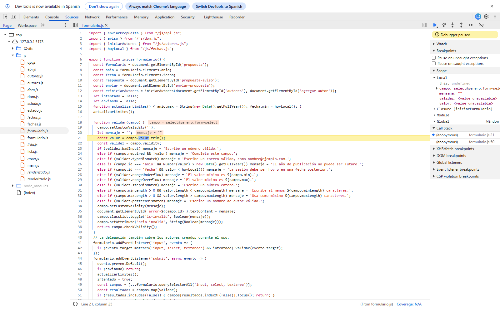

# Depuración y rendimiento

Trabajo y mediciones realizados el 1 de noviembre de 2026. Las capturas son del navegador real; los archivos JSON conservan los datos observados. No se inventaron errores ni resultados de medición.

## Error encontrado: no era posible seleccionar Novela

**Síntoma:** la prueba del formulario esperaba seleccionar `Novela` y no encontraba esa opción. La lista mostraba los otros géneros. El fallo de la prueba llevó a inspeccionar el formulario, en lugar de cambiar la expectativa para ocultarlo.

**Localización con punto de interrupción:** se activó el depurador de Chrome mediante Chrome DevTools Protocol y se colocó un breakpoint en `validar`, antes de leer `campo.value`, condicionado a `campo.id === 'genero'`. Al enviar el formulario se pausó la ejecución en el campo de género. La captura corresponde a la interfaz real de DevTools en Sources.

Se inspeccionaron `campo.value`, `campo.options` y `campo.outerHTML`. El registro [depuracion-pausa.json](capturas/depuracion-pausa.json) muestra que las opciones eran “Selecciona un género”, “Cuento”, “Poesía”, “Ensayo”, “Biografía” y “Otro”. Faltaba “Novela”.

**Causa:** en `buscador-js/index.html`, el fragmento era `</option>Novela</option>`, sin la apertura `<option>` de Novela. El navegador lo trataba como texto dentro del select, no como una opción seleccionable. No era un error de `fetch` ni de las reglas de validación.

**Corrección:** se agregó la apertura y se repitió el recorrido del formulario. La opción se selecciona, se validan los campos y se envían los cinco autores. El commit “Corrige la opción de novela encontrada al probar el formulario” contiene el cambio y la evidencia. Las líneas de la captura corresponden al módulo servido por Vite, que puede añadir líneas al transformar imports.

## Otra corrección durante las pruebas

La animación de cambio de estado aplicada al fondo del `tr` quedaba tapada por el fondo de los `td` de Bootstrap. Se pasó la animación a `.lectura.cambiando > td`. La opacidad de eliminación permanece en la fila completa. También se oscureció `$danger` para mejorar el contraste de los botones de quitar sobre el fondo claro.

## Medición de la carga inicial

Entorno: Chrome, servidor local de **producción** (`npm run build` y `npm run preview`), nueva sesión sin caché previa y sin realizar búsquedas. El servidor sirve recursos comprimidos. Las imágenes de Open Library no forman parte de esta carga porque todavía no se consultó el catálogo.

| Medida | Antes | Después |
| --- | ---: | ---: |
| Transferencia total registrada por Network/CDP | 64 715 bytes | 40 215 bytes |
| Eventos de carga finalizada registrados | 6 | 6 |
| CSS descomprimido | 232 573 bytes | 170 817 bytes |
| JavaScript descomprimido | 91 771 bytes | 33 956 bytes |

La transferencia inicial disminuyó **24 500 bytes (37,86 %)**. El tamaño CSS sin compresión disminuyó 26,55 % y el JavaScript 63,00 %. Los tamaños de transferencia incluyen cabeceras y compresión, por lo que no coinciden con la suma de los tamaños de archivos fuente.

Los datos sin procesar están en [red-antes.json](capturas/red-antes.json) y [red-despues.json](capturas/red-despues.json). `recursos` corresponde a Resource Timing; `peticiones` en estos dos registros cuenta eventos `Network.loadingFinished`. Para distinguir eventos y solicitudes únicas, se incluye además [red-detalle.json](capturas/red-detalle.json) con las URLs y [red-final.har](capturas/red-final.har). La captura de Network permite contrastar la carga final en las herramientas del navegador.

## Optimización aplicada

Antes se importaba todo Bootstrap en Sass y `import { Modal } from 'bootstrap'` traía el paquete JavaScript completo. Después:

1. `scss/_bootstrap.scss` importa únicamente configuración, grilla, utilidades y componentes usados. Se excluyen carrusel, acordeón, tooltips, popovers, toasts y otros componentes sin uso.
2. `js/renderizado.js` importa directamente `bootstrap/js/dist/modal`.
3. Se recompilaron ambas aplicaciones y se volvió a medir el buscador con el mismo procedimiento.

Las portadas usan `loading="lazy"`, dimensiones explícitas y tamaño M; esto evita descargar todas las imágenes fuera de pantalla de inmediato y limita saltos de diseño. No se atribuye a estas medidas la reducción anterior: se conservaron en ambos escenarios.

## Pruebas funcionales

[pruebas.json](capturas/pruebas.json) registra el último recorrido: búsqueda al enviar, texto externo seguro, modal, duplicados, cambios, eliminación al terminar la transición, movimiento reducido, límites de autores, año/fecha y envío, filtros y formulario React. Se comprobaron capturas a 1440 y 390 píxeles y no hubo excepciones JavaScript durante ese recorrido.

Las respuestas de red se simulan en `tests/navegador.cjs` para cubrir resultados vacíos y errores HTTP de manera repetible. Los fallos HTTP intencionales pueden aparecer en la consola de red como recursos fallidos; no son excepciones sin manejar de la aplicación. El manejo `try/catch` los convierte en mensajes visibles.

La comprobación separada [servicios-reales.json](capturas/servicios-reales.json) obtuvo 12 resultados reales para Carmen Lyra y una respuesta POST HTTP 201 de JSONPlaceholder. Esto comprueba conectividad durante esa ejecución, no garantiza disponibilidad futura de servicios ajenos.
